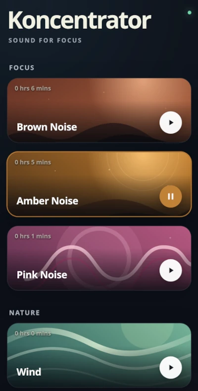

# Koncentrator

Koncentrator is a lightweight web app for playing ambient audio, designed to improve focus. Browse sound tiles grouped by category, then start or stop a sound with a click. Only one sound plays at a time, and each clip loops indefinitely. There is a configurable equal-power crossfade for a smoother transition between loops.

## Configure audio tiles

Edit [`src/config.json`](src/config.json). 

Each entry describes one tile:

| Property | Description |
| --- | --- |
| `title` | Tile label |
| `category` | Category heading used to group the tile |
| `audio` | Audio file in the `audio/` folder |
| `image` | Tile artwork in the `images/` folder |
| `accent` | Tile accent color |
| `crossfadeSeconds` | Crossfade duration at each loop boundary, in seconds; use `0` for seamless wrapped audio |

Note: For audio files with a mathematically wrapped waveform, set `crossfadeSeconds` to `0` to use a single native looping source without the crossfade scheduler.

## Install and use offline

Koncentrator can be installed from browsers that support progressive web apps. When supported by the browser, the Media Session API exposes the playing sound and play, pause, and stop controls in the device's media notifications and lock screen.